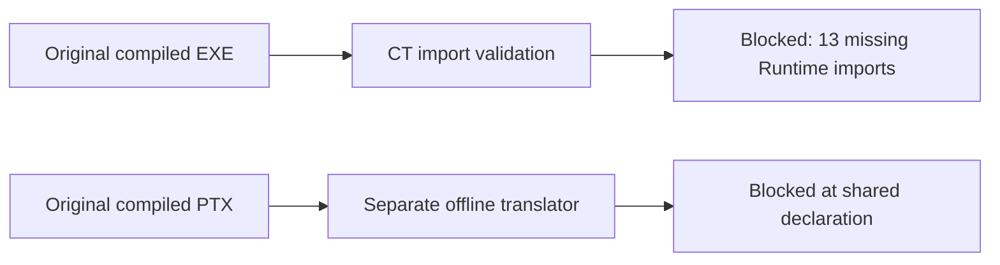

# Original matrixMul: measured blockers and loader diagnostics

Verified 2026-10-26, working-checkout diagnostic. **matrixMul did not execute**;
its GPU kernels did not run. Compilation, PE inspection and offline translation
did run. This is not app compatibility, performance or clean acceptance.

## Original source and build

[Official matrixMul source](https://github.com/NVIDIA/cuda-samples/blob/2b689228b746248b7bb7d2778d5ea0701669f7d3/Samples/0_Introduction/matrixMul/matrixMul.cu)
is pinned at `2b689228b746248b7bb7d2778d5ea0701669f7d3`, blob
`98c4184c94b3edc02e4ecd60a62c7056955e741b`. Source and six Common headers retain
their canonical Git bytes and notices. Vendor source remains ignored locally.

The authenticated nvcc12.0.76 recipe uses shared cudart, PTX8/sm52, default
device-runtime registration and the existing diagnostic MSVC override. This is
**upstream_adjusted_build**, not the original build recipe or distributed binary.
No EXE/PTX/source patch or substitute kernel was used.

The existing minimal package set lacked cuda_profiler_api.h. The original sample
was not edited: the official12.0.76 Windows profiler header archive was downloaded,
verified against its pinned SHA256, and supplied as a separate include directory.
The original toolkit/package trees were not overwritten. Build succeeded with
local Windows SDK encoding warnings retained in logs; supported-host qualification
is still absent.

## Actual first connection barrier

The compiled EXE imports13 Runtime names outside CT's current26-export profile:

| Requirement | Missing names |
| --- | --- |
| Device attributes | cudaDeviceGetAttribute |
| Pinned host memory | cudaHostAlloc, cudaFreeHost |
| Stream and asynchronous copies | cudaStreamCreateWithFlags, cudaStreamSynchronize, cudaMemcpyAsync |
| Events and timing | cudaEventCreate, cudaEventRecord, cudaEventSynchronize, cudaEventElapsedTime, cudaEventDestroy |
| Profiling control | cudaProfilerStart, cudaProfilerStop |

Source cudaMallocHost is represented by cudaHostAlloc in these actual imports.
The strict public CT run command returned exit2 with `unsupported static Runtime
symbol`, before staging/launching the application. This is an observed
**CT static-import preflight barrier**, not a measurement of the first
runtime-called CUDA function. No success stubs or missing-import bypass were added.

## Separate offline kernel barrier

The original compiled PTX was inspected with the actual CT module translator.
It returned exit3, `line=32 category=unsupported`, at the first `.shared`
declaration. Static inspection finds4 shared declarations,4 block barriers and48
fma.rn.f32 instructions across the two16/32 template kernels. These are textual
occurrences, not executed counts or a complete list of remaining PTX requirements.



The PTX barrier was investigated independently; the application did not reach it
during execution. Shared address spaces/arrays, block visibility and participation,
and fused arithmetic semantics need their own implementation and tests. A fused
multiply-add cannot be silently replaced by separately rounded multiply and add.

## Product change: explicit read-only import diagnostics

```powershell
python scripts/ct.py inspect --runtime --diagnostic path/to/matrixMul.exe
```

This now returns unsupported_imports with specific missing names,
compatibility:blocked and execution_performed:false. Exit0 means inspection
completed, not that the application runs. A known-symbol-only image remains
compatibility:unproven. The legacy cuda_loading field describes Driver imports;
the Runtime's actual static imports are shown separately in the imports list.

Default inspect_pe behavior and public run/prepare_bundle remain strict. Malformed
PE structures, delay/ordinal CUDA imports and unsupported Runtime versions still
fail. Diagnostic reporting never grants execution. Unit tests explicitly prove
a diagnosed missing-import image cannot reach run_child.

## Evidence and regression checks

- Recheck from the public relative manifest path reproduced all13 missing names,
  strict run denial and the offline `.shared` rejection. Original observations
  are preserved; recheck writes a new observation directory/report.
- The actual per-run translator EXE and all six original stdout/stderr files are
  hash-bound. Invocation arguments and typed exit codes are checked; the audit
  reconstructs every diagnostic field, including no-execution flags and nested
  PTX data. A bool/int or status relabel cannot qualify saved evidence.
- A fresh external vectorAdd capture passed nominal, observed and NaN-noop
  controls, plus the6 guarded actual-kernel Driver cases. Its unchanged EXE/DLLs
  then passed the public CT run command under the final loader code. That
  regression reuses its recorded build identity; it is not relabelled as a new
  clean/source-tree acceptance after recorder-only edits.
- Python **180 passed**. Rust workspace **151 passed,0 failed,3 ignored**;
  Runtime **77 passed**. Workspace fmt/clippy and static profile/coverage checks
  passed. Matrix PTX was rejected, so no matrix SPIR-V validator pass is claimed.
- Independent review found translator/raw-output binding gaps. These were fixed
  and re-reviewed without new actionable findings. Recorder assumptions about the
  existing translator protocol and relative recheck paths were corrected, with
  regression tests; failed exploratory captures remain unqualified locally.

## Next implementation order

1. Define a truthful device-query bridge/profile. Existing Driver attributes can
   be forwarded where supported; physical Intel properties, virtual CUDA feature
   targets and unavailable attributes must be distinguished. Do not invent a
   compute capability merely to satisfy the helper.
2. Start the P06 host-allocation ownership/flags/free contract, then P07 pending
   submission/completion resource lifetime. This gives real foundations for
   cudaHostAlloc/cudaFreeHost and later asynchronous copies.
3. Add P08 streams/events only over that lifetime model: ordering, default-stream
   rules, pending destruction and delayed errors. Event elapsed time requires
   validated timing semantics; CPU wall time is not GPU event time.
4. In the compiler lane, implement bounded static shared memory and uniform block
   barriers, then required fused arithmetic with independent numerical cases.
   Standalone kernels can be tested before all Runtime imports are available.
5. Revisit profiler control with an explicit supported policy, then rerun the
   original external app when the full frontiers are covered. Use independent
   finite/output checks rather than trusting its success or performance text.

An individual export or compiler feature will not by itself make matrixMul pass.
The historical execution roadmap remains the broader coverage/dependency map.

## Identities and local reproduction

| Item | SHA256 |
| --- | --- |
| Source fingerprint | `ae97065bab9f035f35bccb467e3bd8a385eece0c45f1b52e1dc2f82e9b60e3dc` |
| Matrix capture manifest | `0eba2f22a7f86e65bc3b5d501fe65c7a3b090fac72146296f2522d0dea185242` |
| Original matrix source | `ac470baa613a391e90f148c064cc60320395419995beb3b0e8ad8ba43bdfa8bb` |
| Original generated matrix EXE | `ba5b446799d4373d23f37fd570ac0620cf086098f4e2b3c7f03c951b0f77ed1e` |
| Matrix PTX | `999de47c5a9d2610641f37fd5a949523d3e29c3b6c257d5dff7f65e9359ec07b` |
| Actual translator | `6058a9d4089980c1d02ca66ea86e935e4587e81659fc886e6106d7ede9891503` |
| Official profiler archive | `e8bccbfda35abc7076ba6623578d11d05966a9c7fed817cbfe7d4dea9627057e` |
| Profiler header | `c8973678f0c821e7a3938e0ce37fd6af49c3b4995b215b204c1959002f558322` |
| Public-CLI vectorAdd regression EXE | `11241ba005d38ba0fb0dae6df45179262f2402c873060e340d07050644f765c6` |

```powershell
python scripts/triage_matrixmul.py
$taskCapture = (Get-Content -Raw .cache/matrixmul-triage-latest.json | ConvertFrom-Json).manifest
python scripts/triage_matrixmul.py --recheck $taskCapture
python -m unittest discover -s tests -p test_loader_diagnostics.py
python -m unittest discover -s tests -p test_matrixmul_triage.py
```

The runner requires the exact cached source/header/package pins and reports a
new manifest path. The latest pointer was written after this session's verified
recheck. Raw sources, logs, binaries, paths and reports stay ignored under
.cache; user-owned files and historical acceptance worktrees are preserved.
No matrix GPU execution, new CUDA API export, device repair, AMD/NVIDIA parity,
framework support, performance or52-case clean-lane qualification is claimed.
