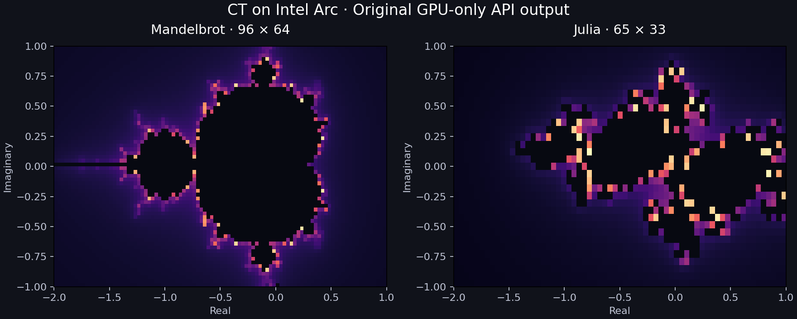

# Original GPU API render demo · 2026-11-18

## 한국어

CT의 로컬 개발 스냅샷으로 원본 Fractal Studio의 GPU-only API를 Intel Arc B390에서 실행했다. 원본 소스는 변경하지 않았고 CPU fallback이나 호스트 결과 주입을 사용하지 않았다. 첫 프리셋 `z**2+c`, f32 Mandelbrot/Julia에 한정한 결과다.

이미지는 GPU에서 다운로드한 필드의 색상 시각화다. 왼쪽 Mandelbrot 96×64, 오른쪽 Julia 65×33이며 원본 GUI 화면 캡처는 아니다.

## Conditions and measurements

- Windows x64, current Intel Arc B390; pinned Numba 0.65.1, prepared toolkit and explicit process-local CT memory/metadata adapters.
- Unchanged upstream source: [Fractal Studio formulas](https://github.com/shimmeringvoid/Fractal_Studio/blob/fb588d662cbb62ce971cec761ce198d02632ec83/core/formulas.py).
- Cases: Mandelbrot 1×1, 33×17, 65×33, 96×64; Julia 65×33. Iteration limits 16/32/64. Real domain [-2,1), imaginary domain [-1,1); Julia c=-0.7269+0.1889i.
- Two fresh processes × two sessions × five cases: **20 original API GPU launches/downloads, 43,984 values**.
- Every interior/escape classification agreed with an independent reference. **43,412 values were bit-identical**; the other **572** differed within the predeclared absolute tolerance **2e-4**. Maximum observed smooth-field absolute difference: **0.00000190735**.
- All four GPU sessions returned bit-identical arrays to each other. The separate mathematical reference uses exact rational f32 FMA/coordinate rounding and host logarithms for smoothing; it does not run upstream CPU code.
- Original no-launch, no-download, and zero-iteration controls were rejected. Independent raw-PTX tests also checked new math, bitcasts, comparisons and allocation guards. These original-app field checks do not imply bit identity with NVIDIA.
- At the measured snapshot: Rust **322 passed / 7 ignored**, separate Runtime **129 passed**, Python **513 passed**. An independent reviewer also interpreted the generated integer-division SPIR-V for **226,608 input pairs** against exact rational results; that count is CPU interpretation, not additional GPU execution.

## Availability and limits

This publication updates documentation and the actual-output image. The latest execution implementation and prepared environment are **not included in this documentation-only commit**. The README's pinned public examples remain a separate, older execution path. A clean-clone recipe for this latest demo is still being prepared.

Only the pinned first-preset f32 GPU API on this prepared Arc environment was verified. Full GUI integration, other presets, f64 rendering, larger frames/iteration limits, another PC/GPU, NVIDIA reference execution and performance advantages remain unverified. The system driver was not replaced.

## Evidence identity and image review

- Tested local integration source fingerprint: `14dad3e132ed9b3e39dd833824e5d12126adb68d3487dad751592993b46d5dd1`.
- Tested provider SHA256: `93c63ca356fb8efa2a0f86af89ba800399a135d8eb7e53f0f8a31db79282d1af`.
- Image SHA256: `39d42d69f9e9279a7087c0d6f53393c3ddf10d295867d92d11dd3e425e5e6e2f` (1760×704 PNG, 65,983 bytes).
- The image was copied byte-for-byte from the audited GPU-field visualization. Manual pixel/content and PNG metadata review found only the fractal plot, generic axis/device labels, Matplotlib software metadata and DPI. No personal paths, unique device identifiers, credentials, screenshots of accounts, raw logs, upstream PTX or native containers are published here.
