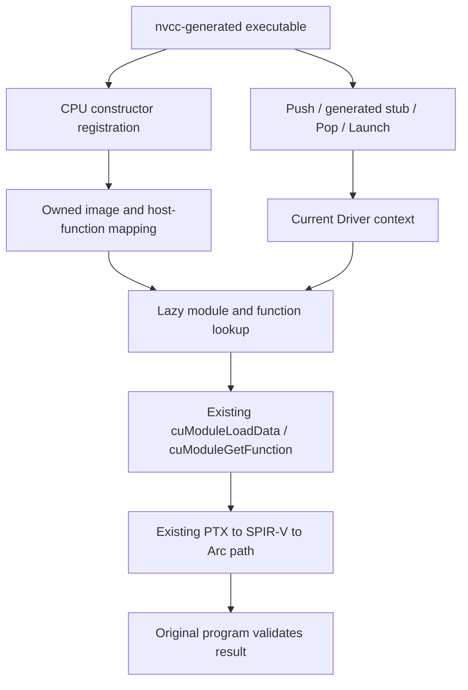

# P09a2: compiler-generated CUDA registration and kernel launch

Status: design and basic-then-default sequence approved by the user's
2026-10-22 request, "우선 1번하고 2번 하자". Detailed implementation plans
are being prepared for review; no product implementation has started. Basis: P09a1 execution candidate24ef127 and
[real nvcc preflight observations](../../P09a2-PRODUCER-PROBE.md).

## 1. Purpose and measurable scope

Connect existing CUDA host programs to the same CT Driver and Intel backend,
preserving executable and embedded GPU-code bytes. Success must include the
compiler's actual registration/launch stub, rather than a hand-written launcher
or a separate PTX demo. Keep Rust, app-local loading, existing14 API behavior,
Driver38 ABI, privacy scans and all11 original user-file hashes unchanged.

There are three independently verified steps:

1. P09a2-A: add bounded nvcc12 container decoding, retaining existing nvFatbin
   validation and budgets. Real compressed/uncompressed input and malformed
   variants establish the decoder boundary before Runtime support changes.
2. P09a2-B: first genuine Runtime kernel profile,14+7=21 exports. Use real
   `--cudart=shared --cudadevrt=none`, PTX-containing non-RDC fixtures. This
   producer restriction must be visible in every result; it does not establish
   compatibility with default nvcc device-runtime linking.
3. P09a2-C: default build input, including version2 prelinked metadata and
   `__cudaRegisterVar`,14+8=22 exports. Design/validate this separately before
   accepting its import/profile. This follow-up is not included in the first21
   implementation approval. Unused unsupported registrations may be deferred
   generically, but their actual use must fail deterministically. No private
   device-runtime function/module-name exemption or blanket no-op callback.

Diagnostic producer execution using the observed unsupported host is allowed as
bounded research evidence, labeled with its exact flags/STL selection. Qualified
supported-host producer behavior is a separate gate and cannot inherit that pass.
Neither scope is a release/general CUDA/framework/AMD/NVIDIA claim.

## 2. Alternatives and choice

| Approach | Assessment |
| --- | --- |
| Reuse original NVIDIA cudart | Preserve as a separate investigation; its additional Driver requirements are not implemented or verified |
| Eagerly load GPU modules in constructor callbacks | Rejected: registrations occur before main and may run under DLL loader lock, before a context exists |
| CPU registration followed by lazy Driver module/function materialization | Recommended: keeps one Driver state, respects existing current contexts and permits accurate per-module errors |

Do not link ct-cuda/backend code into ct-cudart. Reuse the pure CT fatbin decoder
through a path dependency if nested-workspace metadata/build checks confirm it;
do not copy a second decoder. Root Cargo/user files remain untouched. Snapshot
trusted caller-owned image and name bytes while they are valid; retained raw host
pointers are not a source-lifetime strategy. Arbitrary host storage readability
remains a C-ABI caller precondition, as for existing APIs.

## 3. Data flow

Registrations, launch configuration and native materialization are separate
states. Registration callbacks never call the bridge, load/pin DLLs, initialize
GPU/context, translate/JIT, synchronize, free native resources, wait for active
GPU work or perform file/log IO. Every registry lock is released before any
stateful bridge/Driver call. Unregister never takes a materialization lock or
waits for an active caller. This removes the specified lock inversion; broader
arbitrary loader-lock reentrancy remains unverified. First21 profile qualifies
EXE constructors first; DLL constructor/unload coverage must precede DLL support.

## 4. Registration and identity

Add CPU-only image, registration and launch modules inside ct-cudart. A token is
opaque to consumers and never dereferenced on input: look up its identity in CT's
registry. Stable token storage/tombstones prevent token address reuse during the
process; publish no pointer to a movable collection element. First-profile bounds:
64 live registrations,1024 lifetime token identities,512 functions per registration,
4096 live host mappings,1024 bytes per name and64MiB of owned raw images in total.
Each raw image retains the decoder16MiB bound. Native loaded+retired module slots
share a128-slot process bound, checked before acquiring a new native module; a
retained/failed slot is not evicted to make room. Budget exhaustion returns801
(null for RegisterFatBinary), while a detected fallible allocation failure returns2. Retirement
still succeeds at capacity. These are explicit preview limits, not unlimited
plugin unload/reload support. The plan must specify exact accounting and tests.
Use fallible reservations for owned image/name/config growth and define decoder
allocation-error propagation where added. Existing infallible Rust allocator
exhaustion can abort rather than unwind; catch_unwind does not contain that abort.
Do not claim universal recoverable host-OOM handling from the callback panic guard
or a byte budget. This limit must remain explicit until all such paths are changed.

Registration state is Building → Ready or Failed(code), then Retired.
RegisterFatBinary validates/snapshots the observed wrapper24-byte x64 layout,
magic0x466243b1 and supported version. Version1 must follow the observed raw image
contract; it is not the raw fatbin header itself. For stepB, version2 is explicitly
outside the profile. Unsupported images never become runnable by token creation.

RegisterFunction copies the bounded device symbol and associates the actual host
function address, owning registration and compiler metadata. Resolve by host
function identity; do not dereference host machine code or select a kernel by
name/hash shortcut. Validate the observed thread-limit/optional-field contract.
Repeated identical registration within one token may be idempotent; conflicting
duplicates fail that mapping. Cross-token host-address ambiguity fails explicitly
instead of selecting a convenient candidate. Broader COMDAT/ODR alias semantics
remain a follow-up until independently observed and verified.

RegisterFatBinaryEnd closes Building state. Invalid/duplicate end and registration
after end have explicit tested behavior. A malformed RegisterFatBinary returns
null with a bounded error. Void callbacks capture their failure in per-token or
mapping state; launch exposes the relevant failure. They do not poison unrelated
valid registrations, clear prior TLS errors or pretend GPU work succeeded.
All ABI entries contain Rust panics; signatures that return void/pointers need
their own containment instead of the existing integer boundary alone.

## 5. Decoder profile

Recognize the observed nvcc record72 layout and flags0x41/plain or0x2041/compressed
as a distinct profile. Do not merely broaden the old flag whitelist or infer that
all reserved/option bytes are interchangeable. Verify record versions, sizes,
reserved fields, compressed length/padding, decoded limits and NUL termination;
reject unknown options or layout combinations. Preserve raw image16MiB, PTX
256KiB,8 candidates and aggregate decoded1MiB limits unless separately redesigned.

Reuse the existing bounded decompressor only after genuine nvcc samples and
independent payload comparisons establish compatibility. Decoder tests must cover
both producers' valid inputs, truncated headers/records, reserved/flag mutations,
integer overflow, wrong decoded length, bad padding, excessive expansion and
mixed-profile records. Existing nvFatbin option restrictions must remain strict.
Archive genuine producer bytes locally; publish CT-owned synthetic mutations and
a reproducible authenticated producer recipe, not vendor headers/binaries.

## 6. Launch ABI and TLS

New stepB entries are RegisterFatBinary/End, RegisterFunction, UnregisterFatBinary,
PushCallConfiguration, PopCallConfiguration and cudaLaunchKernel. Do not infer
their return types from names: official Push returns unsigned, Pop returns
cudaError_t and has a void* stream-output argument; RegisterFunction/End/Unregister
return void. Validate all against pinned original headers in independent TUs and
actual typed Rust entries. Test Windows x64 dim3-by-value (three u32 fields),
size_t and stream/argument-pointer ABI using actual compiler-generated calls.

Use a64-entry per-thread configuration stack. Push validates nonzero dimensions,
shared bytes and stream without causing GPU work; device-specific limits are
checked later at Launch after a current context exists. Only zero shared memory and
null/default stream are supported initially. Failed Push does not publish config.
Pop validates all four outputs before consuming the top. Null output returns1
without consuming config; an empty stack or a zero-dimension Push returns9.
Unsupported stream/shared or a full stack returns801. Failed Push does not push;
Pop then consumes the previous valid top if one exists. A successful Pop writes
all four outputs and removes exactly one entry. Nested/two-thread ordering and
the real generated caller are tested. The generated stub passes argument-storage pointers
to cudaLaunchKernel; consume them during the synchronous call without retaining
stack addresses or guessing argument sizes from host-side metadata.

Launch resolves a live Ready host mapping, rejects unsupported stream/shared/shape
inputs, preserves an existing ordinary current context, and uses the Runtime's
existing primary policy only when no context exists. Snapshot a launch lease
before releasing the registry lock. A launch that acquired a live lease may finish
while unregister retires it; calls beginning after retirement fail. Caller must
still coordinate unloading its own executing host code.

Before materialization, query the actual current context's device and the existing
Driver attributes1..7 (max thread volume, block axes and grid axes). Nonpositive
or malformed descriptors fail999. Use checked block-volume arithmetic and axis/
volume/grid limit comparisons; violations return Runtime9 without native launch.
Direct cudaLaunchKernel calls also reject any zero grid/block axis with9, even
when the caller bypasses Push/Pop.
Do not classify every Driver1 as a configuration error: malformed arguments and
device pointers still map to1. Also prevalidate the existing backend's per-axis
`grid[axis] * block[axis] <= u32::MAX` limit with widened arithmetic, returning9
on violation. This preserves CT's existing representable-indexing restriction;
it is not a general NVIDIA grid-size restriction. Boundary fixtures distinguish
all shape failures from argument failures.

The Driver continues to validate actual PTX parameter types, pointer ownership,
alignment, argument count contract and eager completion. Extend the pinned same
Driver bridge lazily with ModuleLoadData/GetFunction/LaunchKernel/ModuleUnload
and DeviceGetAttribute (five existing Driver symbols). Resolve the complete
extension before use. Existing14 memory calls do not require
extension resolution. Cache failure once, without a second Driver/DLL registry.

## 7. Context-specific native lifetime

Materialization keys include registration identity and actual Driver context,
never just device ordinal or kernel name. Concurrent first use of a key must load
once; other contexts receive separate module/function handles. Reserve a bounded
native slot before loading. A successful native handle is always transferred to
an owned context-bearing cache/retire record, including load-success followed by
function-lookup failure. Never discard a newly created handle on an error path.
Publication synchronizes with retirement: if unregister won while loading, the
late module goes to the retired record instead of reappearing as a Live cache.
An existing live lease may finish; no new lease may be granted. Partial/native
failure with uncertain cleanup retains its reservation/handle rather than making
capacity look available. The plan must test these interleavings with barriers.
Unregister marks
the token/mappings retired immediately and transfers native handles to a retire
queue without Driver calls. Active snapshots own their copied inputs and prevent
premature resource reclamation; no GPU cleanup is hidden in Arc/Box/TLS destructors.

Drain eligible retired native modules only from explicit stateful calls outside
loader lock, with the matching current context and no active lease. Never switch
away from the caller's ordinary context merely to clean a queue. Ineligible/stale
resources remain retained according to documented process-lifetime bounds. Cleanup
failure preserves handles and a deterministic failure state; no double-free or
automatic retry/reuse of uncertain resources. Context reset/stale709 does not
cause transparent module resurrection. This is not exact NVIDIA deallocation
timing or automatic unload/reload/reset recovery.

## 8. Error and loader boundary

Keep existing14 Driver error mappings unchanged. Add operation-specific mapping
rather than changing old Driver400/218 behavior globally. Profile policy uses
InvalidConfiguration9 for configuration errors, InvalidDeviceFunction98 for an
unknown/retired/ambiguous host mapping or missing device symbol, InvalidValue1
for malformed pointers/fields and NotSupported801 for unsupported valid features.
Module-load Driver218 maps to Runtime InvalidPtx218; module/function/launch400
maps to InvalidResourceHandle400; lookup500 maps to98. Remaining supported
Driver errors keep the existing explicit table (including201→49,709→709 and
unknown→999). Verify enum names/values independently with the fixed official
headers before code, and add static names/descriptions for the new codes. This
defines a bounded CT policy, not verified NVIDIA error-order parity. Success preserves prior TLS
error, GetLastError clears it and failed operations set it. No raw source/host
paths/native logs enter Runtime error strings.

Extend the Runtime manifest/header/import library and exact opt-in PE whitelist
to21 only after the corresponding ABI/native gates exist. Existing default
Driver-only behavior stays restrictive. StepC's22nd entry and version2 handling
must not be enabled early merely to satisfy PE loading. No ordinal/delay/other
cudart versions, launch-ex, stream/PTDS or static-cudart claim is added.

## 9. Default producer follow-up

Version2's extra field contains null-terminated pointers to raw prelinked fatbins,
not wrapper pointers. Its own empty raw payload does not waive those dependencies.
Bound traversal/copy limits, cycles/aliases and each raw image extent explicitly.
RegisterVar must record validated owned symbol metadata; it cannot silently be
discarded because a private vendor symbol looks irrelevant. CPU-only metadata
acceptance may defer materialization of an unused module generically. Actual use
of an unsupported variable/module/function must fail; a kernel that needs global
storage cannot run with its global semantics omitted. Default source tests must
prove both the unused-registration path and explicit rejection of a used unsupported
path, without vendor-name matching. Full global/constant/device-function linking
depends on P03/P04 and remains a separate capability.

## 10. Evidence required before each completion claim

Retain all38 current required gates. Add new named tests only through an exact
catalog/recipe reviewed at planning time; do not invent a passing count now.
Required additions cover:

- Decoder genuine compressed/plain records, adversarial bounds and old-profile
  strictness; input byte/hash preservation and independent decompressed payload.
- Official new ABI and compiler-generated calls, Rust panic/void/pointer boundaries,
  registry failures, budgets/duplicates/stale tokens and per-thread config errors.
- Fake Driver exact module/function materialization counts, context isolation,
  missing extension and rollback/cleanup faults; no native work during registration.
- Unchanged actual nvcc EXE → actual CT cudart → same CT Driver → Arc results,
  guards and input preservation. Include single/multiple kernels and modules,
  non-divisible grids, different contexts, repeated/parallel first use and teardown.
- Wrong/no-op launch providers must be rejected by an independent numerical oracle.
  A callback observer, hand-written host stub or standalone PTX execution cannot
  substitute for the required Runtime EXE. Native manifests bind actual PE imports,
  EXE/image/DLL hashes and complete observations; runner independently re-executes
  artifacts as in P09a1 rather than trusting child success JSON.
- Separate exact diagnostic-host flags/results from a qualified supported-host
  producer lane. Expose absent/failed qualifications as unverified, never a pass.
- Whole implementation review, fixed clean candidate, existing/new required lanes,
  independent artifact audit, public-file/identity scans and11 user-file hashes.

This spec and the probe must be reviewed before a detailed implementation plan
sets limits, error mappings, interfaces, test IDs and staged acceptance. No Runtime
registration/launch or decoder product code was changed during this preflight.

Independent read-only review identified an initial shape-error/bridge mismatch:
Driver1 covers both shapes and arguments, so four module/launch symbols alone
could not implement this policy. The design now includes DeviceGetAttribute and
explicit Runtime prevalidation, the existing CT global-index bound, atomic late
retirement ownership and a precise fallible-allocation/allocator-abort boundary.
The reviewer rechecked these changes and reported no remaining design blocker.
